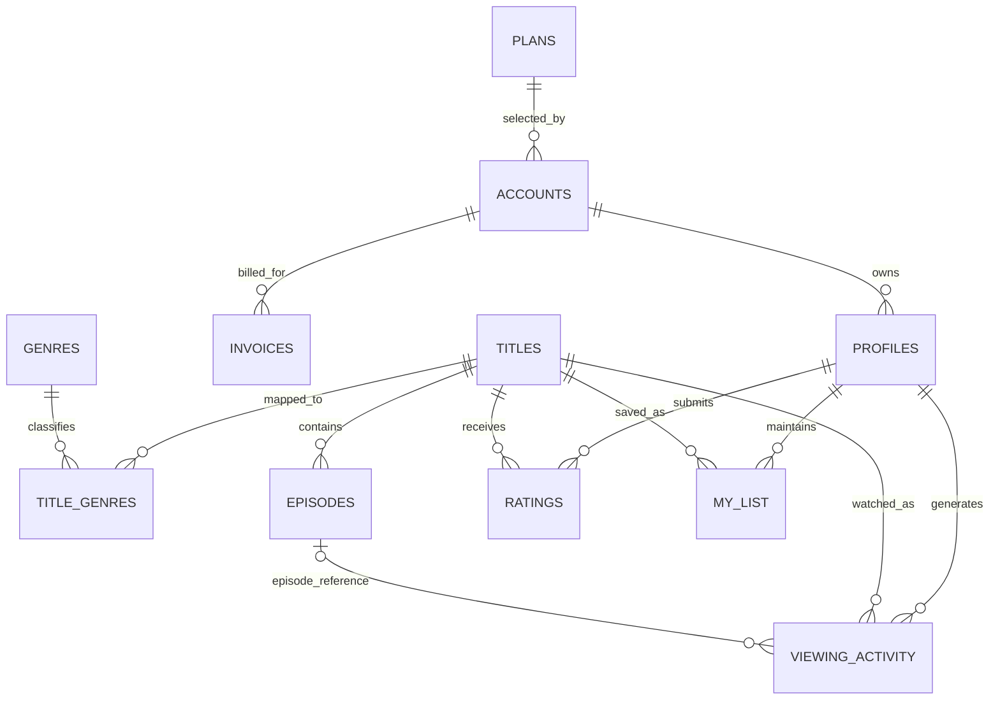

# Netflix Streaming Database — Schema Design

**Project:** Netflix Movie & Series Streaming Database  
**Database:** PostgreSQL  
**Database name used for validation:** `netflix_db`  
**Schema:** `netflix`  
**Phase:** 2 — Schema Design and Data Loading  
**Status:** Implemented and validated against the supplied seed data

---

## 1. Purpose and scope

This document describes the relational schema implemented for the Netflix streaming database. It records the source CSV structure, PostgreSQL data types, keys, constraints, relationships, normalization decisions, data-loading order, and validation results.

The design is based on the 11 supplied CSV files. Column names follow the CSV headers exactly. The implemented definitions are taken from `sql/01_schema.sql`, and the loading process is defined in `sql/02_load_data.sql`.

### 1.1 Dataset overview

| No. | Table | Source file | Rows loaded | Columns | Purpose |
|---:|---|---|---:|---:|---|
| 1 | `plans` | `plans.csv` | 4 | 6 | Subscription plan definitions |
| 2 | `accounts` | `accounts.csv` | 25,000 | 9 | Customer accounts and subscription status |
| 3 | `profiles` | `profiles.csv` | 75,000 | 7 | Viewing profiles belonging to accounts |
| 4 | `genres` | `genres.csv` | 15 | 2 | Genre lookup values |
| 5 | `titles` | `titles.csv` | 3,000 | 10 | Movies and series in the catalogue |
| 6 | `title_genres` | `title_genres.csv` | 5,963 | 2 | Mapping between titles and genres |
| 7 | `episodes` | `episodes.csv` | 20,000 | 7 | Episodes belonging to series |
| 8 | `viewing_activity` | `viewing_activity.csv` | 200,401 | 8 | Playback/viewing events |
| 9 | `ratings` | `ratings.csv` | 33,900 | 4 | Ratings submitted by profiles |
| 10 | `my_list` | `my_list.csv` | 59,992 | 3 | Titles saved by profiles |
| 11 | `invoices` | `invoices.csv` | 133,057 | 6 | Account billing records |
| | **Total** | **11 CSV files** | **556,332** | **70** | |

### 1.2 Schema conventions

| Design area | Convention used |
|---|---|
| PostgreSQL namespace | All 11 tables are created in schema `netflix`. |
| Identifiers | `INTEGER` is used for IDs. |
| Money | `NUMERIC(10,2)` is used for INR amounts. |
| Date-only values | `DATE` is used where a time of day is not required. |
| Timestamp values | `TIMESTAMPTZ` is used for timestamp fields. |
| Boolean values | CSV `t`/`f` values are stored as PostgreSQL `BOOLEAN`. |
| Phone numbers | Stored as `VARCHAR`, not numeric, because they are identifiers and may contain formatting or leading zeroes. |
| Keys and constraints | Only primary keys, foreign keys, unique constraints, `NOT NULL`, and `CHECK` constraints are defined in this phase. |
| Performance indexes | No manually designed performance indexes are created in Phase 2. PostgreSQL automatically creates indexes for primary keys and unique constraints. |

A blank optional CSV field is imported as SQL `NULL`. A `NULL` value is used only where the field is genuinely optional or not applicable; it is not used as a substitute for zero or an empty string.

---

## 2. Data dictionary

The following tables document the **implemented schema**, not merely proposed column definitions.

Column meanings are inferred from the supplied column names and data. Constraint names refer to the definitions in `sql/01_schema.sql`.

### 2.1 `plans` — subscription plan lookup

**Rows:** 4  
**Primary key:** `plan_id`  
**Referenced by:** `accounts.plan_id`

| Column | PostgreSQL type | NULL allowed? | Key / implemented constraint | Description |
|---|---|---:|---|---|
| `plan_id` | `INTEGER` | No | PK | Unique identifier of a subscription plan. |
| `plan_name` | `VARCHAR(20)` | No | UNIQUE | Plan name, such as MOBILE, BASIC, STANDARD, or PREMIUM. |
| `monthly_price_inr` | `NUMERIC(10,2)` | No | CHECK `monthly_price_inr >= 0` | Monthly subscription price in Indian rupees. |
| `max_streams` | `SMALLINT` | No | CHECK `max_streams > 0` | Maximum number of simultaneous streams allowed. |
| `max_resolution` | `VARCHAR(10)` | No | CHECK in `480p`, `720p`, `1080p`, `4K` | Maximum supported streaming resolution. |
| `has_ads` | `BOOLEAN` | No | — | Indicates whether the plan includes advertisements. |

**Observed data:** Four plans are present. Their prices are ₹149, ₹199, ₹499, and ₹649. The supplied rows all have `has_ads = FALSE`; this observation is not enforced as a permanent rule.

**Functional dependency:**  
`plan_id → plan_name, monthly_price_inr, max_streams, max_resolution, has_ads`

`plan_name` is also declared UNIQUE and therefore is an alternate candidate key.

### 2.2 `accounts` — customer subscription accounts

**Rows:** 25,000  
**Primary key:** `account_id`  
**Parent table:** `plans`

| Column | PostgreSQL type | NULL allowed? | Key / implemented constraint | Description |
|---|---|---:|---|---|
| `account_id` | `INTEGER` | No | PK | Unique customer account identifier. |
| `email` | `VARCHAR(254)` | No | UNIQUE | Email address associated with the account. |
| `phone` | `VARCHAR(20)` | Yes | UNIQUE | Optional phone number. Multiple NULL values are permitted by PostgreSQL UNIQUE semantics. |
| `country_code` | `CHAR(2)` | No | CHECK in `IN`, `AE`, `SG` | Two-character country code; the implemented check matches the supplied dataset. |
| `plan_id` | `INTEGER` | No | FK → `plans.plan_id`; ON DELETE RESTRICT | Subscription plan currently associated with the account. |
| `signup_date` | `DATE` | No | — | Date on which the account was created. |
| `status` | `VARCHAR(20)` | No | CHECK in `ACTIVE`, `CANCELLED`, `ON_HOLD` | Current account status. |
| `cancelled_on` | `DATE` | Yes | Conditional CHECK | Cancellation date; required for CANCELLED accounts and absent for other statuses. |
| `next_billing_date` | `DATE` | Yes | Conditional CHECK | Next billing date; required for ACTIVE and ON_HOLD accounts and absent for CANCELLED accounts. |

**Implemented cross-column rule (`chk_account_billing_status`):**

| Account status | `cancelled_on` | `next_billing_date` |
|---|---|---|
| `CANCELLED` | Must be NOT NULL | Must be NULL |
| `ACTIVE` | Must be NULL | Must be NOT NULL |
| `ON_HOLD` | Must be NULL | Must be NOT NULL |

**Observed NULL pattern:** `phone` is absent in 4,888 account rows. There are 2,979 CANCELLED accounts; those rows have a cancellation date and no next billing date. ACTIVE and ON_HOLD accounts have no cancellation date and have a next billing date.

**Functional dependency:**  
`account_id → email, phone, country_code, plan_id, signup_date, status, cancelled_on, next_billing_date`

`email` is an alternate candidate key because it is UNIQUE. `phone` is also declared UNIQUE; PostgreSQL allows multiple NULLs in that column.

### 2.3 `profiles` — viewing profiles

**Rows:** 75,000  
**Primary key:** `profile_id`  
**Parent table:** `accounts`

| Column | PostgreSQL type | NULL allowed? | Key / implemented constraint | Description |
|---|---|---:|---|---|
| `profile_id` | `INTEGER` | No | PK | Unique viewing profile identifier. |
| `account_id` | `INTEGER` | No | FK → `accounts.account_id`; ON DELETE RESTRICT | Account that owns the profile. |
| `profile_name` | `VARCHAR(50)` | No | — | Display name of the profile. |
| `is_kids` | `BOOLEAN` | No | — | Indicates whether the profile is a kids profile. |
| `maturity_limit` | `VARCHAR(10)` | No | Conditional CHECK | Maximum maturity category allowed for the profile. |
| `language` | `VARCHAR(30)` | No | — | Preferred language of the profile. |
| `created_at` | `TIMESTAMPTZ` | No | — | Timestamp when the profile was created. |

**Implemented rule (`chk_profile_maturity`):**

| `is_kids` | Allowed `maturity_limit` values |
|---|---|
| TRUE | `U`, `UA7` |
| FALSE | `A`, `UA13`, `UA16` |

**Observed data:** 10,000 profiles are kids profiles and 65,000 are non-kids profiles. Every account has between 1 and 5 profiles in the supplied data.

**Important enforcement note:** The maximum of five profiles per account is verified against the dataset, but is **not** enforced by the current table constraints. A normal row-level CHECK constraint cannot count rows belonging to the same account. Database enforcement would require a trigger or suitable application/transaction logic.

**Functional dependency:**  
`profile_id → account_id, profile_name, is_kids, maturity_limit, language, created_at`

### 2.4 `genres` — genre lookup

**Rows:** 15  
**Primary key:** `genre_id`  
**Referenced by:** `title_genres.genre_id`

| Column | PostgreSQL type | NULL allowed? | Key / implemented constraint | Description |
|---|---|---:|---|---|
| `genre_id` | `INTEGER` | No | PK | Unique genre identifier. |
| `genre_name` | `VARCHAR(40)` | No | UNIQUE | Name of the genre. |

**Functional dependency:**  
`genre_id → genre_name`

`genre_name` is an alternate candidate key because it is UNIQUE.

### 2.5 `titles` — catalogue titles

**Rows:** 3,000  
**Primary key:** `title_id`  
**Referenced by:** `title_genres`, `episodes`, `viewing_activity`, `ratings`, `my_list`

| Column | PostgreSQL type | NULL allowed? | Key / implemented constraint | Description |
|---|---|---:|---|---|
| `title_id` | `INTEGER` | No | PK | Unique catalogue title identifier. |
| `title_type` | `VARCHAR(10)` | No | CHECK in `MOVIE`, `SERIES` | Indicates whether the title is a movie or a series. |
| `name` | `VARCHAR(255)` | No | — | Display name of the title. |
| `release_year` | `SMALLINT` | No | CHECK from 1888 through 2100 | Year in which the title was released. |
| `maturity_rating` | `VARCHAR(10)` | No | CHECK in `U`, `UA7`, `UA13`, `UA16`, `A` | Content maturity rating. |
| `original_language` | `VARCHAR(30)` | No | — | Original language of the title. |
| `runtime_min` | `SMALLINT` | Yes | Conditional CHECK | Runtime in minutes; required for movies and NULL for series. |
| `is_netflix_original` | `BOOLEAN` | No | — | Indicates whether the title is a Netflix Original. |
| `added_on` | `DATE` | No | — | Date on which the title was added to the catalogue. |
| `leaving_on` | `DATE` | Yes | CHECK `leaving_on IS NULL OR leaving_on >= added_on`; Originals rule | Date on which a non-Original title leaves the catalogue, if applicable. |

**Implemented title rules:**

| Rule | Implemented condition |
|---|---|
| Valid title type | `title_type IN ('MOVIE', 'SERIES')` |
| Valid maturity rating | `maturity_rating IN ('U', 'UA7', 'UA13', 'UA16', 'A')` |
| Movie runtime | `title_type = 'MOVIE'` requires `runtime_min IS NOT NULL AND runtime_min > 0` |
| Series runtime | `title_type = 'SERIES'` requires `runtime_min IS NULL` |
| Leaving date | `leaving_on` cannot be earlier than `added_on` |
| Netflix Originals | If `is_netflix_original = TRUE`, `leaving_on` must be NULL |

**Observed data:** The catalogue contains 2,000 movies and 1,000 series. All movies have a runtime; all series have NULL title-level runtime. There are 610 Netflix Originals, and none has a leaving date.

**Functional dependency:**  
`title_id → title_type, name, release_year, maturity_rating, original_language, runtime_min, is_netflix_original, added_on, leaving_on`

### 2.6 `title_genres` — title-to-genre mapping

**Rows:** 5,963  
**Composite primary key:** (`title_id`, `genre_id`)  
**Parent tables:** `titles`, `genres`

| Column | PostgreSQL type | NULL allowed? | Key / implemented constraint | Description |
|---|---|---:|---|---|
| `title_id` | `INTEGER` | No | PK part; FK → `titles.title_id`; ON DELETE CASCADE | Title associated with the genre. |
| `genre_id` | `INTEGER` | No | PK part; FK → `genres.genre_id`; ON DELETE CASCADE | Genre associated with the title. |

The composite primary key prevents the same genre from being assigned more than once to the same title. The two foreign keys ensure that both referenced records exist.

**Relationship:** `titles` and `genres` have a many-to-many relationship through this bridge table.

**Functional dependency:**  
`(title_id, genre_id) →` no additional non-key attributes.

The pair is the complete key; neither column alone identifies a mapping row.

### 2.7 `episodes` — series episodes

**Rows:** 20,000  
**Primary key:** `episode_id`  
**Parent table:** `titles`

| Column | PostgreSQL type | NULL allowed? | Key / implemented constraint | Description |
|---|---|---:|---|---|
| `episode_id` | `INTEGER` | No | PK | Unique episode identifier. |
| `title_id` | `INTEGER` | No | FK → `titles.title_id`; ON DELETE RESTRICT | Series title to which the episode belongs. |
| `season_no` | `SMALLINT` | No | CHECK `season_no > 0` | Season number. |
| `episode_no` | `SMALLINT` | No | CHECK `episode_no > 0` | Episode number within the season. |
| `episode_title` | `VARCHAR(255)` | No | — | Name of the episode. |
| `runtime_min` | `SMALLINT` | No | CHECK `runtime_min > 0` | Episode runtime in minutes. |
| `release_date` | `DATE` | No | — | Episode release date. |

**Additional implemented UNIQUE constraints:**

| Constraint | Purpose |
|---|---|
| `UNIQUE (title_id, season_no, episode_no)` | Prevents duplicate episode positions within a title. |
| `UNIQUE (episode_id, title_id)` | Provides a unique composite key referenced by `viewing_activity`. |

**Observed data:** All 20,000 episode rows reference titles whose `title_type` is `SERIES`.

**Enforcement note:** The current foreign key verifies that the referenced title exists. It does not itself enforce that the referenced title has `title_type = 'SERIES'`. That cross-table rule was validated against the supplied data.

**Functional dependencies:**  
`episode_id → title_id, season_no, episode_no, episode_title, runtime_min, release_date`  
`(title_id, season_no, episode_no) → episode_id, episode_title, runtime_min, release_date`

Both determinants are candidate keys under the implemented constraints.

### 2.8 `viewing_activity` — playback events

**Rows:** 200,401  
**Primary key:** `view_id`  
**Parent tables:** `profiles`, `titles`, and optionally `episodes`

| Column | PostgreSQL type | NULL allowed? | Key / implemented constraint | Description |
|---|---|---:|---|---|
| `view_id` | `INTEGER` | No | PK | Unique playback event identifier. |
| `profile_id` | `INTEGER` | No | FK → `profiles.profile_id`; ON DELETE RESTRICT | Profile that performed the playback. |
| `title_id` | `INTEGER` | No | FK → `titles.title_id`; ON DELETE RESTRICT | Movie or series being watched. |
| `episode_id` | `INTEGER` | Yes | Composite FK with `title_id` → `episodes(episode_id, title_id)`; ON DELETE RESTRICT | Episode watched; NULL for movie playback in the supplied data. |
| `started_at` | `TIMESTAMPTZ` | No | — | Timestamp when playback started. |
| `duration_watched_sec` | `INTEGER` | No | CHECK `duration_watched_sec > 0` | Duration watched, in seconds. |
| `device_type` | `VARCHAR(10)` | No | CHECK in `TV`, `MOBILE`, `TABLET`, `LAPTOP` | Device used for playback. |
| `completed` | `BOOLEAN` | No | — | Whether the viewing event is marked as completed. |

**Why is `episode_id` nullable?** Movie playback does not refer to an episode. The supplied data has 93,056 viewing rows with NULL `episode_id` and 107,345 rows with a non-NULL `episode_id`.

**Composite foreign-key design:** `episodes` declares `UNIQUE (episode_id, title_id)`. `viewing_activity` references that pair. This ensures that when an episode is supplied, it belongs to the same title stored in the viewing row. The separate `title_id` foreign key also validates the title reference.

**Enforcement note:** The composite foreign key does not, by itself, require every SERIES viewing row to have an episode or prohibit an episode on a MOVIE viewing row. Those rules depend on `titles.title_type` and require trigger/application logic if they must be enforced for future data. The supplied data passed the corresponding checks.

**Functional dependency:**  
`view_id → profile_id, title_id, episode_id, started_at, duration_watched_sec, device_type, completed`

### 2.9 `ratings` — profile ratings of titles

**Rows:** 33,900  
**Composite primary key:** (`profile_id`, `title_id`)  
**Parent tables:** `profiles`, `titles`

| Column | PostgreSQL type | NULL allowed? | Key / implemented constraint | Description |
|---|---|---:|---|---|
| `profile_id` | `INTEGER` | No | PK part; FK → `profiles.profile_id`; ON DELETE RESTRICT | Profile that submitted the rating. |
| `title_id` | `INTEGER` | No | PK part; FK → `titles.title_id`; ON DELETE RESTRICT | Title being rated. |
| `rating` | `VARCHAR(20)` | No | CHECK in `THUMBS_UP`, `THUMBS_DOWN`, `LOVE` | Rating value submitted by the profile. |
| `rated_at` | `TIMESTAMPTZ` | No | — | Timestamp when the rating was submitted. |

The composite primary key permits one current rating per profile/title pair. Different profiles can rate the same title.

**Functional dependency:**  
`(profile_id, title_id) → rating, rated_at`

### 2.10 `my_list` — saved titles per profile

**Rows:** 59,992  
**Composite primary key:** (`profile_id`, `title_id`)  
**Parent tables:** `profiles`, `titles`

| Column | PostgreSQL type | NULL allowed? | Key / implemented constraint | Description |
|---|---|---:|---|---|
| `profile_id` | `INTEGER` | No | PK part; FK → `profiles.profile_id`; ON DELETE RESTRICT | Profile that saved the title. |
| `title_id` | `INTEGER` | No | PK part; FK → `titles.title_id`; ON DELETE RESTRICT | Title saved in the profile's list. |
| `added_at` | `TIMESTAMPTZ` | No | — | Timestamp when the title was added to the list. |

The composite primary key prevents a profile from saving the same title more than once while allowing multiple profiles to save the same title.

**Functional dependency:**  
`(profile_id, title_id) → added_at`

### 2.11 `invoices` — account billing records

**Rows:** 133,057  
**Primary key:** `invoice_id`  
**Parent table:** `accounts`

| Column | PostgreSQL type | NULL allowed? | Key / implemented constraint | Description |
|---|---|---:|---|---|
| `invoice_id` | `INTEGER` | No | PK | Unique invoice identifier. |
| `account_id` | `INTEGER` | No | FK → `accounts.account_id`; ON DELETE RESTRICT | Account to which the invoice belongs. |
| `billing_period_start` | `DATE` | No | CHECK day is 1; UNIQUE with `account_id` | First date of the billing month. |
| `amount_inr` | `NUMERIC(10,2)` | No | CHECK `amount_inr >= 0` | Amount charged or recorded for the invoice, in INR. |
| `status` | `VARCHAR(10)` | No | CHECK in `PAID`, `FAILED`, `REFUNDED` | Invoice/payment status. |
| `paid_at` | `TIMESTAMPTZ` | Yes | Conditional CHECK | Payment timestamp; NULL for failed invoices. |

**Implemented invoice rules:**

| Rule | Implemented condition |
|---|---|
| Non-negative amount | `amount_inr >= 0` |
| Allowed statuses | `PAID`, `FAILED`, `REFUNDED` |
| Billing period | `EXTRACT(DAY FROM billing_period_start) = 1` |
| One invoice per account per billing month | `UNIQUE (account_id, billing_period_start)` |
| Failed invoice | `status = 'FAILED'` requires `paid_at IS NULL` |
| Paid/refunded invoice | `status IN ('PAID', 'REFUNDED')` requires `paid_at IS NOT NULL` |

**Observed data:** There are 127,619 PAID invoices, 4,764 FAILED invoices, and 674 REFUNDED invoices. Every billing period begins on day 1. All FAILED rows have NULL `paid_at`; PAID and REFUNDED rows have a payment timestamp.

**Invoice amount and plan price:** The supplied invoice amounts match the account's current plan price in the exported data. `amount_inr` is retained because an invoice should preserve the amount recorded at billing time. The current schema does not store plan-change history, so the current account plan should not be treated as definitive historical billing evidence.

**Functional dependencies:**  
`invoice_id → account_id, billing_period_start, amount_inr, status, paid_at`  
`(account_id, billing_period_start) → invoice_id, amount_inr, status, paid_at`

The second dependency is supported by the implemented UNIQUE constraint on account and billing period.

---

## 3. Primary keys, candidate keys, and foreign keys

### 3.1 Key summary

| Table | Primary key | Other candidate / alternate key |
|---|---|---|
| `plans` | `plan_id` | `plan_name` |
| `accounts` | `account_id` | `email`; non-NULL `phone` values are UNIQUE |
| `profiles` | `profile_id` | — |
| `genres` | `genre_id` | `genre_name` |
| `titles` | `title_id` | — |
| `title_genres` | (`title_id`, `genre_id`) | — |
| `episodes` | `episode_id` | (`title_id`, `season_no`, `episode_no`) |
| `viewing_activity` | `view_id` | — |
| `ratings` | (`profile_id`, `title_id`) | — |
| `my_list` | (`profile_id`, `title_id`) | — |
| `invoices` | `invoice_id` | (`account_id`, `billing_period_start`) |

### 3.2 Foreign-key summary and implemented deletion actions

| No. | Child table and column(s) | Parent table and column(s) | ON DELETE | Reason |
|---:|---|---|---|---|
| 1 | `accounts.plan_id` | `plans.plan_id` | RESTRICT | A plan referenced by accounts cannot be deleted. |
| 2 | `profiles.account_id` | `accounts.account_id` | RESTRICT | Prevents accidental removal of profiles and related history through account deletion. |
| 3 | `title_genres.title_id` | `titles.title_id` | CASCADE | A title/genre mapping has no independent meaning if its title is deleted. |
| 4 | `title_genres.genre_id` | `genres.genre_id` | CASCADE | A mapping has no independent meaning if its genre is deleted. |
| 5 | `episodes.title_id` | `titles.title_id` | RESTRICT | Prevents deletion of a title while its episodes exist. |
| 6 | `viewing_activity.profile_id` | `profiles.profile_id` | RESTRICT | Preserves playback history references. |
| 7 | `viewing_activity.title_id` | `titles.title_id` | RESTRICT | Preserves playback history references. |
| 8 | `viewing_activity(episode_id, title_id)` | `episodes(episode_id, title_id)` | RESTRICT | Ensures the selected episode belongs to the selected title and preserves episode references. |
| 9 | `ratings.profile_id` | `profiles.profile_id` | RESTRICT | Prevents accidental deletion of rating history. |
| 10 | `ratings.title_id` | `titles.title_id` | RESTRICT | Prevents deletion of a rated title. |
| 11 | `my_list.profile_id` | `profiles.profile_id` | RESTRICT | Prevents accidental removal of saved-list records. |
| 12 | `my_list.title_id` | `titles.title_id` | RESTRICT | Prevents deletion of a title while it is saved in a profile list. |
| 13 | `invoices.account_id` | `accounts.account_id` | RESTRICT | Preserves financial records. |

---

## 4. Relationships and cardinalities

| Parent entity | Child entity | Cardinality | Explanation |
|---|---|---|---|
| `plans` | `accounts` | 1 : N | One plan can be selected by many accounts; each account references one plan. |
| `accounts` | `profiles` | 1 : N | One account can own multiple profiles; each profile belongs to one account. |
| `accounts` | `invoices` | 1 : N | One account can have multiple monthly invoices; each invoice belongs to one account. |
| `titles` | `episodes` | 1 : N | A series title can contain multiple episodes. |
| `titles` | `genres` | M : N | A title can have multiple genres, and a genre can classify multiple titles; implemented through `title_genres`. |
| `profiles` | `titles` through `ratings` | M : N | Profiles can rate multiple titles, and titles can be rated by multiple profiles. |
| `profiles` | `titles` through `my_list` | M : N | Profiles can save multiple titles, and a title can be saved by multiple profiles. |
| `profiles` | `viewing_activity` | 1 : N | A profile can generate many playback events. |
| `titles` | `viewing_activity` | 1 : N | A title can appear in many playback events. |
| `episodes` | `viewing_activity` | 1 : N, optional per event | A viewing event may reference an episode; movie viewing events have no episode in the supplied data. |

### 4.1 Mermaid ER diagram

The Mermaid source above documents the entity relationships. The diagram shows the relationship allowed by the foreign key; although the supplied data has 1–5 profiles per account, the current DDL does not enforce a minimum or maximum profile count. Export the diagram as `diagrams/er_diagram.png` for the repository deliverable.

---

## 5. Normalization and functional dependencies

The schema separates entities and relationships so that each table stores facts about one main entity or association. The following analysis is based on the implemented keys and the functional dependencies identified from the supplied columns.

### 5.1 Functional dependency and normal-form summary

| Table | Determinant / candidate key(s) | Functional dependency | Normal-form reasoning |
|---|---|---|---|
| `plans` | `plan_id`; `plan_name` | Each plan key determines all plan attributes. | 3NF/BCNF: every determinant of a non-trivial dependency is a candidate key. |
| `accounts` | `account_id`; `email` | Each account key determines its account attributes. | 3NF/BCNF: account details are stored once; plan details are kept in `plans`. |
| `profiles` | `profile_id` | `profile_id` determines account reference and profile attributes. | 3NF/BCNF: profile attributes depend on the profile key, not on another non-key attribute. |
| `genres` | `genre_id`; `genre_name` | Each genre key determines the genre name. | 3NF/BCNF: lookup attributes depend on a candidate key. |
| `titles` | `title_id` | `title_id` determines all catalogue attributes. | 3NF/BCNF: title facts are stored in one row; genre and episode relationships are separate. |
| `title_genres` | (`title_id`, `genre_id`) | The pair identifies one title/genre association. | BCNF: the table contains only the composite key attributes. |
| `episodes` | `episode_id`; (`title_id`, `season_no`, `episode_no`) | Either candidate key determines the remaining episode attributes. | 3NF/BCNF: episode facts depend on a complete candidate key. |
| `viewing_activity` | `view_id` | `view_id` determines the profile, title, optional episode, and playback attributes. | 3NF/BCNF: each row represents one playback event. |
| `ratings` | (`profile_id`, `title_id`) | The pair determines `rating` and `rated_at`. | 3NF/BCNF: non-key attributes depend on the whole composite key. |
| `my_list` | (`profile_id`, `title_id`) | The pair determines `added_at`. | 3NF/BCNF: non-key attribute depends on the whole composite key. |
| `invoices` | `invoice_id`; (`account_id`, `billing_period_start`) | Either candidate key determines the remaining invoice attributes. | 3NF/BCNF: invoice facts are stored per invoice; account details remain in `accounts`. |

### 5.2 Why the schema avoids common normalization problems

| Design choice | Normalization benefit |
|---|---|
| Plans are stored separately from accounts. | Plan name, price, stream limit, and resolution are not repeated in every account row. |
| Profiles are stored separately from accounts. | Multiple profiles do not require repeating profile columns in an account row. |
| Genres are stored separately and linked through `title_genres`. | A title can have multiple genres without repeating columns such as `genre_1`, `genre_2`, and `genre_3`. |
| Episodes are stored as separate rows. | A series can have multiple episodes without storing episode lists in a title row. |
| Ratings and My List use composite keys. | Each profile/title association is represented once in the respective table. |
| Viewing activity is stored as individual events. | A profile can watch the same title repeatedly without overwriting earlier playback events. |
| Invoices are separate from accounts. | Multiple billing records can exist for an account without repeating account attributes. |

### 5.3 Potentially redundant or derived attributes retained intentionally

| Attribute(s) | Why they may appear redundant | Why they are retained in this design |
|---|---|---|
| `viewing_activity.completed` vs `duration_watched_sec` and runtime | Completion might be inferred from watched duration and content runtime if a precise completion rule exists. | The supplied data does not define a completion threshold. `completed` is retained as the recorded playback outcome rather than recalculated. |
| `invoices.amount_inr` vs current plan price | The supplied invoice amounts match the account's current plan price. | An invoice should preserve the amount charged at the time of billing. The current plan can change, and the dataset does not include plan-change history. |
| `viewing_activity.title_id` vs `episode_id` | For series playback, the episode identifies its parent title. | Movie playback has no episode ID. Keeping `title_id` for every viewing event supports unified title-level queries; the composite foreign key checks consistency when an episode is present. |
| `episodes.title_id` | The episode has its own `episode_id`. | The title reference identifies the series to which the episode belongs and supports series-level joins and queries. |

---

## 6. Implemented constraints

This section lists constraints that are present in `sql/01_schema.sql`. It does not list unimplemented business rules as though they were already enforced.

### 6.1 CHECK constraints

| No. | Table | Constraint / rule implemented |
|---:|---|---|
| 1 | `plans` | `monthly_price_inr >= 0` |
| 2 | `plans` | `max_streams > 0` |
| 3 | `plans` | `max_resolution IN ('480p', '720p', '1080p', '4K')` |
| 4 | `accounts` | `country_code IN ('IN', 'AE', 'SG')` |
| 5 | `accounts` | `status IN ('ACTIVE', 'CANCELLED', 'ON_HOLD')` |
| 6 | `accounts` | Cancellation date and next billing date must match the account status rule described in §2.2. |
| 7 | `profiles` | Kids/non-kids profile maturity limits must follow the rule described in §2.3. |
| 8 | `titles` | `title_type IN ('MOVIE', 'SERIES')` |
| 9 | `titles` | `release_year BETWEEN 1888 AND 2100` |
| 10 | `titles` | `maturity_rating IN ('U', 'UA7', 'UA13', 'UA16', 'A')` |
| 11 | `titles` | Movies require a positive runtime; series require NULL title-level runtime. |
| 12 | `titles` | `leaving_on` must be NULL or on/after `added_on`. |
| 13 | `titles` | Netflix Originals must have NULL `leaving_on`. |
| 14 | `episodes` | `season_no > 0` |
| 15 | `episodes` | `episode_no > 0` |
| 16 | `episodes` | `runtime_min > 0` |
| 17 | `viewing_activity` | `duration_watched_sec > 0` |
| 18 | `viewing_activity` | `device_type IN ('TV', 'MOBILE', 'TABLET', 'LAPTOP')` |
| 19 | `ratings` | `rating IN ('THUMBS_UP', 'THUMBS_DOWN', 'LOVE')` |
| 20 | `invoices` | `amount_inr >= 0` |
| 21 | `invoices` | `status IN ('PAID', 'FAILED', 'REFUNDED')` |
| 22 | `invoices` | FAILED invoices require NULL `paid_at`; PAID and REFUNDED invoices require non-NULL `paid_at`. |
| 23 | `invoices` | `billing_period_start` must fall on day 1 of a month. |

### 6.2 UNIQUE constraints

| Table | UNIQUE constraint | Purpose |
|---|---|---|
| `plans` | `plan_name` | Prevents duplicate plan names. |
| `accounts` | `email` | Prevents duplicate account email addresses. |
| `accounts` | `phone` | Prevents duplicate non-NULL phone values. |
| `genres` | `genre_name` | Prevents duplicate genre names. |
| `episodes` | (`title_id`, `season_no`, `episode_no`) | Prevents duplicate episode positions within a title. |
| `episodes` | (`episode_id`, `title_id`) | Supports the composite foreign key from viewing activity. |
| `invoices` | (`account_id`, `billing_period_start`) | Allows at most one invoice per account per billing month. |

Primary keys are also unique by definition. PostgreSQL automatically creates indexes to enforce primary-key and UNIQUE constraints. No additional performance indexes are created in this phase.

### 6.3 Rules not enforced by the current DDL

| Business rule | Current status | Why it is not enforced by the current constraints |
|---|---|---|
| Each account can have at most five profiles. | Verified against seed data; not enforced by DDL. | Requires counting related profile rows; a normal CHECK constraint cannot perform this aggregate check. |
| A viewing row for a MOVIE must have NULL `episode_id`. | Verified against seed data; not enforced by DDL. | Depends on `titles.title_type`, which is in another table. |
| A viewing row for a SERIES must have a non-NULL `episode_id`. | Verified against seed data; not enforced by DDL. | Depends on `titles.title_type`, which is in another table. |
| Every episode must belong to a SERIES title. | Verified against seed data; not enforced by DDL. | The current FK checks that the title exists, not its `title_type`. |
| A title must have been added before a viewing event starts. | Not enforced. | Requires comparing timestamps/dates across tables. |
| Invoice amount must equal the plan price at billing time. | Not enforced. | Historical plan information is not stored; current plan price may not represent the historical price. |

These rules can be implemented with triggers or application/transaction logic if required by future project phases. They are not described as implemented constraints.

---

## 7. Data loading implementation

### 7.1 Loading order

`sql/02_load_data.sql` loads parent tables before child tables so that foreign-key references can be satisfied.

| Load order | Table | Reason for position |
|---:|---|---|
| 1 | `plans` | Parent of `accounts`. |
| 2 | `accounts` | Parent of `profiles` and `invoices`; references `plans`. |
| 3 | `profiles` | Parent of `viewing_activity`, `ratings`, and `my_list`. |
| 4 | `genres` | Parent of `title_genres`. |
| 5 | `titles` | Parent of `title_genres`, `episodes`, `viewing_activity`, `ratings`, and `my_list`. |
| 6 | `title_genres` | Requires both `titles` and `genres`. |
| 7 | `episodes` | Requires `titles`. |
| 8 | `viewing_activity` | Requires `profiles`, `titles`, and any referenced `episodes`. |
| 9 | `ratings` | Requires `profiles` and `titles`. |
| 10 | `my_list` | Requires `profiles` and `titles`. |
| 11 | `invoices` | Requires `accounts`. |

### 7.2 Loading method

The project uses PostgreSQL `\copy` commands in `sql/02_load_data.sql`. The script:

1. Begins a transaction.
2. Sets the search path to `netflix`.
3. Imports each CSV file into its corresponding table using `\copy`.
4. Runs `ANALYZE` to update PostgreSQL table statistics.
5. Commits the transaction.

The CSV files remain local seed data and should not be committed to the Git repository if the project instructions require them to be excluded.

---

## 8. Data profiling and validation results

This section records the checks performed on the supplied CSV files and on the loaded PostgreSQL database. A result of zero means no violating rows were returned by that check.

### 8.1 Loaded row-count verification

| Table | Expected rows | PostgreSQL rows | Result |
|---|---:|---:|---|
| `plans` | 4 | 4 | PASS |
| `accounts` | 25,000 | 25,000 | PASS |
| `profiles` | 75,000 | 75,000 | PASS |
| `genres` | 15 | 15 | PASS |
| `titles` | 3,000 | 3,000 | PASS |
| `title_genres` | 5,963 | 5,963 | PASS |
| `episodes` | 20,000 | 20,000 | PASS |
| `viewing_activity` | 200,401 | 200,401 | PASS |
| `ratings` | 33,900 | 33,900 | PASS |
| `my_list` | 59,992 | 59,992 | PASS |
| `invoices` | 133,057 | 133,057 | PASS |
| **Total** | **556,332** | **556,332** | **PASS** |

### 8.2 CSV profiling findings

| Table / field | Observed values or pattern |
|---|---|
| `accounts.country_code` | `AE`, `IN`, `SG` |
| `accounts.status` | `ACTIVE`, `CANCELLED`, `ON_HOLD` |
| `profiles.is_kids` | `TRUE`, `FALSE` |
| `profiles.maturity_limit` | `A`, `UA13`, `UA16`, `U`, `UA7` |
| `profiles.language` | Bengali, English, Hindi, Tamil, Telugu |
| `titles.title_type` | `MOVIE`, `SERIES` |
| `titles.maturity_rating` | `A`, `U`, `UA7`, `UA13`, `UA16` |
| `titles.is_netflix_original` | `TRUE`, `FALSE` |
| `viewing_activity.device_type` | `LAPTOP`, `MOBILE`, `TABLET`, `TV` |
| `viewing_activity.completed` | `TRUE`, `FALSE` |
| `ratings.rating` | `LOVE`, `THUMBS_DOWN`, `THUMBS_UP` |
| `invoices.status` | `FAILED`, `PAID`, `REFUNDED` |

### 8.3 NULL and conditional-value profiling

| Field | Observed NULL / conditional pattern | Design interpretation |
|---|---|---|
| `accounts.phone` | 4,888 rows have no phone value. | Optional contact information; nullable and UNIQUE. |
| `accounts.cancelled_on` | Present for all 2,979 CANCELLED accounts; absent for ACTIVE and ON_HOLD accounts. | Nullable, with status-dependent rule. |
| `accounts.next_billing_date` | NULL for all 2,979 CANCELLED accounts; present for ACTIVE and ON_HOLD accounts. | Nullable, with status-dependent rule. |
| `titles.runtime_min` | Present for all 2,000 movies; NULL for all 1,000 series. | Runtime is stored at title level for movies; series runtime is represented through episodes. |
| `titles.leaving_on` | NULL for all 610 Netflix Originals; 262 non-Original titles have a leaving date. | Nullable catalogue departure date; Originals cannot have a leaving date under the implemented rule. |
| `viewing_activity.episode_id` | NULL in 93,056 viewing rows; non-NULL in 107,345 rows. | NULL for movie viewing in the supplied data; series viewing references episodes. |
| `invoices.paid_at` | NULL for all 4,764 FAILED invoices; present for PAID and REFUNDED invoices. | Payment timestamp depends on invoice status. |

### 8.4 Integrity checks executed in PostgreSQL

The following checks were run after loading the data. They verify business relationships that are not all expressible through the current table constraints.

| No. | Integrity rule tested | SQL check / logic | Result |
|---:|---|---|---:|
| 1 | No account has more than five profiles. | Group `profiles` by `account_id`; return groups where `COUNT(*) > 5`. | 0 violating accounts |
| 2 | A viewing row with an episode ID must reference that episode under the same title ID. | Join `viewing_activity` to `episodes` on both `episode_id` and `title_id`; count unmatched episode references. | 0 invalid references |
| 3 | No movie viewing row should have an episode ID, and no series viewing row should lack one. | Compare `viewing_activity.episode_id` with `titles.title_type`. | 0 movie/series mismatches |
| 4 | Every episode must belong to a SERIES title. | Join `episodes` to `titles`; count rows where `title_type <> 'SERIES'`. | 0 invalid episodes |
| 5 | Invoice payment timestamp must agree with invoice status. | Count FAILED rows with a payment timestamp or PAID/REFUNDED rows without one. | 0 invalid invoices |
| 6 | Netflix Originals must not have a leaving date. | Count titles where `is_netflix_original = TRUE AND leaving_on IS NOT NULL`. | 0 invalid Originals |

**Additional observed validation:** The account profile count ranged from 1 to 5. The title dataset contained 2,000 movies and 1,000 series. All invoice billing periods started on day 1 of the month. The supplied validation checks found no mismatch in the conditions listed above.

### 8.5 Data-quality observations and limitations

| Observation | Treatment |
|---|---|
| Some account phone numbers are blank. | Accepted as NULL because phone is optional in the supplied data. |
| Series have no title-level runtime. | Accepted as NULL because runtime is represented at episode level. |
| Movie viewing rows have no episode ID. | Accepted as NULL because a movie is not an episode of a series. |
| Cancelled accounts have no next billing date. | Accepted and validated through the account status CHECK. |
| Failed invoices have no payment timestamp. | Accepted and validated through the invoice status CHECK. |
| All supplied country codes are `IN`, `AE`, or `SG`. | The current DDL restricts the column to these observed codes. This is a project-scope decision and may need revision if more markets are supported. |
| All supplied plans have `has_ads = FALSE`. | No CHECK forces this value; the column remains available for future plan definitions. |
| Invoice amounts match current plan prices in the supplied export. | The invoice amount remains stored independently as a billing snapshot; no cross-table price equality constraint is added. |

---

## 9. Final implementation summary

| Deliverable / verification | Final state |
|---|---|
| `sql/01_schema.sql` | Executed successfully; creates all 11 tables in schema `netflix`. |
| `sql/02_load_data.sql` | Executed successfully; loads all 11 CSV files. |
| Table row counts | All 11 counts match the expected seed-data counts. |
| Primary and foreign keys | Implemented as documented in this file and the DDL. |
| UNIQUE, NOT NULL, and CHECK constraints | Implemented as documented in this file and the DDL. |
| Manual performance indexes | None created in Phase 2. |
| Integrity checks | Six checks documented in §8.4; all returned zero violations. |
| ER diagram source | Mermaid ER diagram included in §4.1. |
| ER diagram image | Export the Mermaid diagram to `diagrams/er_diagram.png` if it has not yet been added to the repository. |

**Phase 2 schema and data-loading implementation is complete based on the successful SQL execution and validation results recorded above.** The ER diagram image remains a separate repository artifact to verify.
